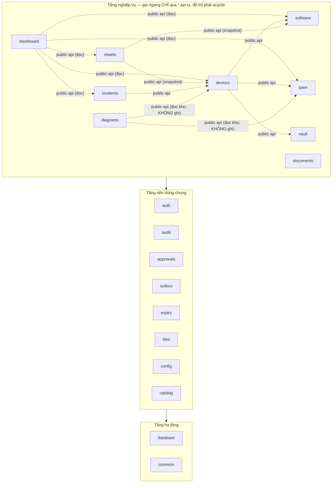

# Architecture Spine — IMS

## Design Paradigm

**Modular monolith** (NestJS): mỗi nghiệp vụ = một module; trong module đi một chiều `controller → service → DB`; service tách `*-read.service.ts` / `*-write.service.ts`. Ranh giới giữa các module nghiệp vụ = **public api service** (AD-2). Data access = **drizzle-orm** (nếp thật của QLTS — ratify, không cải tạo). Frontend React SPA (Vite) gọi REST; UI nền tảng từ `web/ui` QLTS.

## Invariants & Rules

### AD-1 — Modular monolith, layered một chiều, drizzle-orm `[ADOPTED]`

- **Binds:** all
- **Prevents:** mỗi module một kiểu kiến trúc; hai lớp data-access song song (drizzle của code copy + raw SQL viết mới).
- **Rule:** một nghiệp vụ = một NestJS module; trong module chỉ đi `controller → service → DB`; đọc/ghi tách read/write service. Data access thống nhất **drizzle-orm** (như code QLTS copy sang); schema drizzle đặt tại module chủ bảng.

### AD-2 — Ranh giới module = public api service; đồ thị acyclic, enforce bằng CI

- **Binds:** all
- **Prevents:** vòng phụ thuộc kiểu `assets-write→software-license→assets.service` của QLTS; SQL lậu xuyên module.
- **Rule:** mỗi module nghiệp vụ export đúng **một** `*.api.ts` (public api service) qua module exports. Module nghiệp vụ được inject public api của module khác để **đọc/ghi chéo** — cấm import bất kỳ file nội bộ nào của module khác, cấm SQL/JOIN đụng bảng module khác. Đồ thị phụ thuộc giữa các module nghiệp vụ **phải acyclic** — enforce bằng `dependency-cruiser` chạy trong CI, không chỉ review. Tầng nền không import tầng nghiệp vụ.
- **Enforce — vế SQL cần một cổng RIÊNG.** `dependency-cruiser` và eslint canh vế import, và chỉ vế import: cái thứ nhất khớp **đường dẫn đã resolve**, cái thứ hai khớp **chuỗi import**. Một câu SQL thô không phải cái nào trong hai thứ đó, nên `audit-query.service.ts` viết `LEFT JOIN users u ON u.email = a.actor` và sống **chín epic** dưới mũi cả hai cổng (A-07, 21/09) — trong khi `users.api.ts` có sẵn dòng chữ cấm đúng việc ấy. Cái giá đã trả hai lần: `u.sub` không tồn tại nên endpoint 500 ở mọi lần gọi, và `created_at` mơ hồ làm vỡ mỗi lượt lọc ngày. Bản canh: `api/src/ad2-raw-sql.spec.ts` — đọc chủ sở hữu bảng từ chính các `*.schema.ts` (AD-3, không phải danh sách chép tay) rồi quét mọi file đã **lột chú thích**. Cùng doctrine với AD-16: một luật không có bài canh là một luật có thể khớp đúng số không chuỗi mà không ai biết.

### AD-3 — Mỗi bảng một chủ; mọi truy cập chéo qua public api của chủ

- **Binds:** all
- **Prevents:** hai module cùng ghi một bảng; "chỉ đọc" biến thành SELECT lậu.
- **Rule:** chủ bảng duy nhất — `devices`: device, port_map, device_model (ảnh thật theo model — Story 10.11) · `software`: software, license_assignment, renewal_history · `ipam`: subnet, ip_address, ip_history, nat_rule · `vault`: secret, access_list, access_grant · `sheets`: sheet_template, sheet_period, sheet_entry · `incidents`: incident · `approvals`: approval · `audit`: audit_log (ghi qua interceptor) · `auth`: user, session · `catalog`: site, cabinet, device_type, device_type_icon, vendor, cable_type · `diagrams`: diagram, diagram_version, diagram_version_label, diagram_history, diagram_comment (AD-18) · `config`: system_config · `files`: file · `outbox`: outbox · `expiry`: expiry_rule. Module khác không đụng bảng — đọc lẫn ghi đều qua public api của module chủ (vd: devices gọi `ipam.api.assignIp(deviceId, ...)`). FR-005 (trang thiết bị tổng hợp) và FR-027 (dashboard) compose bằng public api, không SQL chéo.

### AD-4 — Bảng secret là lãnh địa cấm

- **Binds:** FR-021..026, FR-036, NFR-02
- **Prevents:** module khác chạm ciphertext/plaintext ngoài đường audit.
- **Rule:** bảng `secret` không xuất hiện trong bất kỳ query nào ngoài module `vault`; public api của vault không bao giờ trả plaintext trừ đúng luồng xem đã step-up TOTP (FR-022/023), mỗi lần giải mã = một dòng audit. TOTP secret của user cũng đi cơ chế envelope này. Vault **không đăng ký** gì vào expiry engine.

### AD-5 — Một request ghi = một transaction, tx truyền tường minh

- **Binds:** all endpoints ghi
- **Prevents:** nghiệp vụ commit nhưng audit/mail rơi mất khi crash; mỗi nơi một kiểu truyền transaction.
- **Rule:** nghiệp vụ + dòng audit + outbox message commit chung hoặc rollback chung trong `db.transaction()` (drizzle). Transaction **truyền tường minh làm tham số** (`tx`) xuống mọi hàm ghi — không AsyncLocalStorage, không connection ngầm. Không gửi mail trực tiếp trong request — mọi email đi qua outbox.

### AD-6 — Một module `approvals` cho mọi luồng duyệt; hiệu lực = expires_at

- **Binds:** FR-023 (break-glass), FR-033 (phiếu), incidents
- **Prevents:** mỗi tính năng tự chế bảng duyệt; grant break-glass "sống mãi" vì không ai đóng.
- **Rule:** mọi luồng xin–duyệt dùng bảng `approval` chung + từ vựng state đăng ký theo loại; state đổi qua `transition()` khai báo, cấm UPDATE status tự do. Grant break-glass mang `expires_at`; **hiệu lực kiểm tại mỗi lần đọc bằng `expires_at > now()`** — không tin status; sweep dọn grant hết hạn chỉ để vệ sinh. Notify duyệt qua outbox email.

### AD-7 — Expiry engine nhận provider, không quét bảng ai

- **Binds:** FR-012..014
- **Prevents:** engine SELECT bảng module khác (phạm AD-3), hoặc quét nhầm bảng secret (phạm AD-4).
- **Rule:** module nghiệp vụ đăng ký **`ExpirySource` provider** (callback trả `{id, label, loại, start, end, link}`); engine chỉ gọi provider + áp luật digest (loại + cửa sổ ngày + người nhận + tần suất, lưu `system_config`) và đẩy email qua outbox. Thao tác "đã gia hạn" (FR-014) gọi public api của module chủ (vd `software.api.renew(...)`) — engine không ghi bảng ai.

### AD-8 — Auth tự xây theo 5 tường `[ADOPTED]`

- **Binds:** NFR-01, NFR-02
- **Prevents:** lệch khỏi thiết kế đã thẩm định chuyên gia (PRD §4–5, addendum §2–3); hai cơ chế CSRF chồng nhau.
- **Rule:** Argon2id + pepper (`@node-rs/argon2` 2.x); TOTP `otplib` 13.x + chống replay (last_used_timestep); session server-side Postgres (kế thừa bảng sessions QLTS, bỏ cột OIDC). CSRF dùng **cơ chế `csrf_token` thừa kế trong bảng sessions QLTS** + kiểm tra header Origin — không thêm thư viện csrf-csrf. Vault AES-256-GCM envelope, AAD = `record_id + key_version + table`, master key qua docker secret file. Không OIDC/IdP, không JWT client-side.

### AD-9 — Mọi endpoint ghi qua `@Audited`, quyền mặc định đóng `[ADOPTED]`

- **Binds:** all controllers
- **Prevents:** endpoint quên audit hoặc quên phân quyền lọt ra production.
- **Rule:** endpoint ghi thiếu `@Audited` = review chặn; controller không khai `@Roles(...)` = 401 (default-secure). Bảng audit append-only (REVOKE UPDATE/DELETE tầng DB role). **Từ 20/09/2026 câu đó mới ĐÚNG với thực tế đang chạy:** trước đó ứng dụng kết nối bằng `ims` — vừa superuser vừa chủ sở hữu — nên REVOKE của `0005` không có hiệu lực nào và chủ sở hữu còn tháo được cả trigger. `0001_app_role.sql` (bộ migration gộp theo bảng, Q-17) tách role `ims_app` (migration chạy bằng chủ sở hữu, ứng dụng chạy bằng role hẹp), và `assertNarrowRole` trong `main.ts` chặn boot ở production nếu `.env` chưa đổi.

### AD-10 — Migration chỉ tiến, seed danh mục là migration

- **Binds:** database
- **Prevents:** sửa lịch sử migration → drift; danh mục cài tay mỗi máy một khác.
- **Rule:** bộ migration mới từ `0000`, đánh số 4 chữ số theo thứ tự merge, chạy qua `migration-runner` QLTS (advisory lock + checksum); không sửa file đã chạy. Seed danh mục (site, tủ, loại thiết bị, vendor, 5 template phiếu nhóm A) là migration đánh số; dữ liệu thật đi đường import Excel (FR-003).

### AD-11 — Cấu hình 2 tầng, cấm hardcode

- **Binds:** all
- **Prevents:** hằng số nghiệp vụ chôn trong code, đổi phải deploy.
- **Rule:** bí mật (master key, pepper, SMTP pass) = docker secret file, không env, không DB. Tham số vận hành (mốc digest, trần 24h, N giây ẩn, ngưỡng lockout) = bảng `system_config`, chỉnh qua UI Admin. Không hằng số nghiệp vụ nào hardcode.

### AD-12 — Repo trắng, copy module QLTS theo bản đồ `[ADOPTED]`

- **Binds:** all
- **Prevents:** fork mang theo rác booking/OIDC; "tận dụng tạm" code auth cũ nửa vời.
- **Rule:** khởi tạo repo mới; copy nguyên: `database/migration-runner`, `audit/`, `outbox/`+`queue/`, `config/`, `files/`, mail hạ tầng, `web/ui`+`web/lib`, docker skeleton. Bỏ: booking/pool, toàn bộ OIDC, directory-sync, chatbot. Khi copy: tách type `AuthedRequest` ra `auth/types.ts`; viết lại `SessionAuthService` bỏ OIDC-refresh; grep quét `PMH_|oidc|openid|login_hint|booking`; `crypto-secret.ts` cũ chỉ dùng cho SMTP. **Version theo code copy: giữ `bullmq` ^5 như QLTS** — không nâng major khi copy.

### AD-13 — Lịch sử nghiệp vụ = bảng history append-only của module chủ

- **Binds:** FR-007, FR-014, FR-018, FR-025
- **Prevents:** nơi render lịch sử từ audit_log, nơi từ bảng riêng — hai nguồn sự thật.
- **Rule:** lịch sử nghiệp vụ hiển thị cho user (lịch sử IP, lần gia hạn, gán license, grant break-glass) = bảng history append-only thuộc module chủ (pattern `allocation_history` QLTS). `audit_log` chỉ phục vụ an ninh/truy vết, không là nguồn render nghiệp vụ.

### AD-14 — Port map: một kết nối = một bản ghi; phiếu autofill = snapshot

- **Binds:** FR-006, FR-029
- **Prevents:** hai trang thiết bị ghi hai bản ghi đối xứng cho cùng sợi dây; phiếu ISO đổi nội dung theo dữ liệu sống sau khi đã chốt kỳ.
- **Rule:** `port_map` = một bản ghi/kết nối `(device_id, port_label, connected_device_id?, note, người dùng)` — hiển thị hai chiều bằng query, không tạo bản ghi đối xứng. Field tự điền trên phiếu (tên job, server…) **snapshot tại thời điểm sinh kỳ** — phiếu là bằng chứng thời điểm, không cập nhật theo dữ liệu sống.

### AD-15 — Dùng chung viết một lần, có nhà cố định và có sổ đăng ký

- **Binds:** toàn bộ UI, FR-028, FR-012..014, FR-022, FR-029, AD-13
- **Prevents:** mỗi màn tự chế popup confirm / dialog / chọn lịch; `ExcelExportService` viết ở Epic 2 rồi viết lại ở Epic 7; badge "sắp hết hạn" mỗi nơi tính một kiểu; sửa một hành vi phải đi sửa 9 chỗ.
- **Rule:** thứ nào dùng ở **≥2 màn hoặc ≥2 module** là tài sản dùng chung — đặt tại `web/src/ui` (UI + hook) hoặc `src/common` + module nền (API), **không** nằm trong `features/` hay module nghiệp vụ. Story sinh ra nó phải khai ngay vào `docs/SHARED-REGISTRY.md` (tên · đường dẫn · dùng ở đâu · khi nào KHÔNG dùng). Story sau **bắt buộc đọc registry trước khi viết mới**; cần khác biệt thì mở rộng bằng prop/tham số/provider, **cấm fork bản sao**. Cụ thể cấm: `window.confirm`/`window.alert`, dialog tự dựng trong `features/`, hex màu ngoài `tokens.css`, tự viết logic phân trang / export xlsx / tính trạng thái hạn. Enforce bằng eslint (`no-restricted-syntax`, `no-restricted-imports`) trong CI, cùng chỗ với `dependency-cruiser` của AD-2 — không chỉ trông vào review.

### AD-16 — Tên định danh trong mã phải là tiếng Anh

- **Binds:** toàn bộ `api/src`, `api/test`, `web/src`, `e2e` — mã sản phẩm và mã kiểm như nhau
- **Prevents:** một cơ sở mã hai ngôn ngữ, nơi `soLuong` và `quantity` cùng tồn tại và không ai biết cái nào là thật; `git grep` tìm một khái niệm phải đoán người viết nghĩ bằng tiếng gì; và cái giá lớn nhất — mỗi định danh tiếng Việt mới sinh ra làm đợt đổi tên sau đó đắt thêm, nên nợ tự nuôi chính nó. Đo 19/09: **237 định danh + 15 tên tệp**, không cổng nào chặn cái mới.
- **Rule:** định danh (biến, hàm, lớp, hằng, thuộc tính, tên tệp) viết bằng **tiếng Anh**. Tiếng Việt chỉ được ở ba nơi: **chú thích**, **mô tả bài kiểm** (`describe`/`it`/`test`), và **bảng ánh xạ nhãn nhập-Excel** (`devices/device-import.ts`, `catalog/catalog-import.ts`) — ở đó chuỗi tiếng Việt là DỮ LIỆU người dùng gõ vào tệp, đổi là hỏng chức năng nhập. Chuỗi hiển thị cho người dùng đi qua `lib/i18n` (DoD gạch 6), không phải ngoại lệ của luật này.
- **Enforce:** `no-restricted-syntax` với selector `Identifier[name=/[À-ỹ]/]` trong cả ba cấu hình eslint (api · web · e2e), cùng chỗ với AD-2/AD-15. **Lớp này chỉ bắt định danh CÓ DẤU**; tiếng Việt không dấu (`soLuong`, `ghi`, `truoc`) cần một từ điển âm tiết — đó là lớp hai, làm cùng đợt đổi tên (mục 3.4 của `docs/RA-SOAT-TOAN-DIEN-2026-09-19.md`).
- **Cổng phải có bài canh cổng.** Luật lint không có bài kiểm là luật có thể khớp **đúng số không chuỗi** mà repo vẫn sạch nên không ai biết — đã xảy ra hai lần ở repo này (AD-2 bên api, 28/08, chín epic; `window.confirm` bên web, 07/09). Bản canh cổng: `api/src/ad16-gate.lint.spec.ts` và `web/src/lint-rules.test.ts`. Rà soát chéo 21/09 tìm ra AD-16 chưa hề áp cho `api/test/**` và bị một khối ngoại lệ đánh rơi ở hai tệp `audit` — cả hai vô hình cho tới khi có bài canh.

### AD-17 — Trình vẽ draw.io là tệp tĩnh ghim phiên bản phát từ `web`; XML bản vẽ là dữ liệu không tin cậy

- **Binds:** FR-037..049, NFR-01, NFR-03, NFR-04, NFR-07
- **Prevents:** trình vẽ bên thứ ba gọi ra Internet hay tự nâng phiên bản; một bản vẽ chứa nhãn `` chạy script trong trang IMS và gọi `/api` bằng phiên của người xem; mã 2 lớp nhập để xem sơ đồ vô tình mở luôn két; "xem bản vẽ" không để lại dấu vết.
- **Rule — phát tệp tĩnh từ `web`:** từ Epic 10, draw.io **không** là service riêng. Image `web` lúc build chép thư mục webapp tĩnh của draw.io từ image `jgraph/drawio` (ghim **tag + digest**, không `latest`; chép bằng `COPY --from=` một stage đúng tag + digest đó) vào cây tệp nginx, phát tại `/drawio/` — không Tomcat, không servlet (`/proxy`, `/export`, `/log`…: không tồn tại thay vì bị chặn), không cổng nào thêm; trình vẽ **cùng host** với IMS và đi chung cert (Q-23, 03/10/2026). Location `/drawio/` chỉ GET/HEAD tệp có đuôi biết trước, chặn `service-worker.js`/`workbox-*`. Container `drawio` (Tomcat, mạng `internal: true`) của bản thử chỉ là tạm, Story 10.2 gỡ nó khỏi compose. Mở bằng `embed=1&proto=json&offline=1&stealth=1&plugins=0&pages=0&configure=1` (cấu hình đẩy qua sự kiện `configure`: tắt nguồn đám mây, bảng màu dây từ token, `compressXml: false`). Nâng phiên bản 1–2 lần/năm hoặc khi có cảnh báo bảo mật: đổi tag + digest của stage nguồn trong `web/Dockerfile` → dựng lại `web` → chạy E2E sơ đồ → giữ tag cũ để lùi (RUNBOOK). Trang sửa báo "Trình vẽ chưa sẵn sàng" nếu không nhận sự kiện `init` trong `diagram.editor_init_timeout_seconds`.
- **Rule — nhúng:** chỉ một cầu nối `web/src/ui/drawio-frame` (AD-15) được tạo iframe trình vẽ. Iframe mang `sandbox="allow-scripts"` — **không** `allow-same-origin`, không `allow-top-navigation`, không `allow-popups`, không `allow-downloads` (xuất file đi qua server); **kết quả Story 10.2 (03/10/2026): chỉ `allow-scripts` là đủ** — draw.io 31.6.1 tự host chạy nhúng trong iframe `sandbox="allow-scripts"` + CSP `sandbox allow-scripts`, `script-src 'self'` (không `'unsafe-inline'`: `index.html` không có script nội tuyến), trình duyệt thật nhận đủ `configure → init → load → export`, 0 request ra ngoài, 0 lỗi CSP; `allow-downloads` bỏ vì xuất file đi qua lệnh `export` của cầu nối rồi qua server; `allow-modals` bỏ vì hộp thoại của draw.io là DOM của chính nó — `alert`/`confirm` trình duyệt chỉ còn ở vài nhánh dự phòng (đổi tên lỗi, thư viện localStorage vốn đã không chạy ở origin mờ), bị chặn thì im lặng, không ảnh hưởng nạp/sửa/lưu; origin mờ cần `Access-Control-Allow-Origin: *` trên tệp tĩnh `/drawio/` vì draw.io tải tệp ngôn ngữ/hình bằng XHR khác nguồn. Cờ nào muốn thêm sau này thì chứng minh và ghi vào đây — nên chạy ở origin mờ, không đọc được cookie/DOM/`localStorage` của IMS, gọi `/api` không kèm phiên. Bên IMS chỉ nhận tin khi `event.source === iframe.contentWindow` và dữ liệu đúng hình dạng giao thức (bỏ qua tin lạ, không `eval`); bên draw.io nhận tin chỉ từ `window.parent` (hành vi embed sẵn có). CSP của IMS thêm `frame-src 'self'` (chặn iframe điều hướng đi nơi khác); location `/drawio/` có CSP riêng: `connect-src 'self'`, `img-src 'self' data: blob:`, `frame-ancestors 'self'`, không host ngoài. Nếu spike chứng minh draw.io không chạy được ở origin mờ thì đường lùi là **origin riêng** (`drawio.ims.pmh.com.vn`, cùng cert wildcard, cùng nginx) — **không** thêm `allow-same-origin`: sandbox có cả `allow-scripts` lẫn `allow-same-origin` trên trang cùng origin là sandbox tự gỡ được.
- **Rule — XML/SVG không tin cậy:** server là cổng duy nhất vào kho bản vẽ. Mỗi lần lưu: kiểm cỡ (`diagram.xml_max_kb`, `diagram.svg_max_kb`, `diagram.max_cells`), parse bằng parser tắt DTD/thực thể ngoài, đúng **một** trang, không nén; từ chối 400 khi gặp `<script`, thuộc tính `on*`, `javascript:`/`vbscript:`/`data:text/html`, thuộc tính `link` của ô, ảnh không phải `data:image/(png|jpeg|webp)` hoặc SVG đã lọc; nhãn HTML lọc theo allowlist thẻ định dạng. SVG để xem do trình vẽ xuất lúc lưu, server làm sạch theo allowlist (bỏ script, `on*`, `foreignObject`, `href` ra ngoài, `<use>` trỏ ngoài) rồi mới lưu; **kết quả Story 10.2:** draw.io 31.6.1 xuất nhãn HTML dạng `<switch><foreignObject>…</foreignObject><text>chữ thuần</text></switch>`, nên cổng bỏ hẳn `foreignObject` (không cần allowlist XHTML) — nhãn còn ở `<text>`; cổng cũng bỏ `<a>` (draw.io chỉ dùng cho dòng "Text is not SVG" trỏ về drawio.com), `<style>`, `animate`/`set` và thuộc tính `content` (bản sao nén của bản vẽ). Ảnh trong XML: nhận `data:image/(png|jpeg|webp|gif)`, `data:image/svg+xml` không chứa URL (khai báo `xmlns` không tính là URL), và đường tương đối tới ảnh có sẵn của draw.io (`img/…`, `stencils/…`); URL tuyệt đối, `//host`, `..` bị từ chối. Thuộc tính của `UserObject` đều kiểm như nhãn HTML vì `placeholders=1` chèn chúng vào nhãn. Cổng là `api/src/modules/diagrams/diagram-gate.ts` (bộ đọc XML + allowlist SVG dùng chung với biểu tượng loại thiết bị ở `api/src/common/svg-sanitize.ts`). SVG để xem giữ `<image>` mang `data:image/svg+xml` (biểu tượng SVG riêng của loại thiết bị, đã lọc lúc tải lên): SVG nạp làm ảnh chạy chế độ tĩnh, không script, không tải ngoài. **Chế độ xem không chạy draw.io:** IMS chèn SVG đã làm sạch vào DOM của trình xem dùng chung (`web/src/ui/diagram-viewer`), lắp tương tác (bấm ô, tô sáng, bay tới, lớp) bằng `data-cell-id` + chỉ mục ô do server dựng (AD-18). Trình vẽ chỉ nạp XML đã qua cổng server.
- **Rule — step-up có phạm vi:** step-up mang phạm vi `vault | diagram`, mỗi phạm vi một mốc trên `sessions` (`stepped_up_at` cho két, `diagram_stepped_up_at` cho sơ đồ) và một ân hạn trong `system_config` (`secret.stepup_grace_minutes`, `diagram.stepup_grace_minutes`). `@RequiresStepUp()` giữ nghĩa két; route nội dung sơ đồ — và mọi route SỬA một bản vẽ có sẵn (lưu phiên bản, đặt tên, khôi phục, nhịp "đang sửa") — khai `@RequiresStepUp('diagram')`; route khác của module khai `@NoStepUp()` rõ ràng. Nhập mã ở phạm vi nào chỉ đóng dấu phạm vi đó; **mã lúc đăng nhập không mở phạm vi nào** — kể cả két (chủ dự án xác nhận 03/10/2026; hệ quả thấy được: lần xem secret đầu tiên sau đăng nhập cũng hỏi mã, mở sơ đồ hỏi mã riêng, mỗi bên ân hạn riêng): hiện `completeTotpWithin` của đăng nhập đóng dấu `stepped_up_at`, Story 10.1 bỏ việc đó (Q-23 "nhập ở đâu tính ở đó"; mã đăng nhập chứng minh danh tính, không phải ý định mở két); bộ đếm gõ sai dùng chung cho hai phạm vi. Đọc nội dung (`diagram.viewed`) và xuất (`diagram.exported`) đều ghi audit — đây là ngoại lệ có chủ ý của nếp "chỉ audit thao tác ghi", cùng loại với audit giải mã két (AD-4).

### AD-18 — Module `diagrams`: lớp nhìn đọc kho, không ghi kho; hợp đồng gắn dữ liệu bằng thuộc tính ô

- **Binds:** FR-037..049, AD-2, AD-3, AD-5, AD-13, AD-14
- **Prevents:** sơ đồ cổng có hai đường ghi (bảng trang thiết bị + nét vẽ) rồi lệch nhau; một sợi dây xoá trên bản vẽ tầng làm mất kết nối đang hiện ở bản vẽ tổng; module `devices` phải biết `diagrams` tồn tại (vòng phụ thuộc); lịch sử bản vẽ bị sửa ngược.
- **Rule — sở hữu:** module nghiệp vụ `diagrams` là chủ duy nhất `diagram` (cây; `kind = official | presentation`; bản trình bày là hàng `diagram` có `source_diagram_id` + `source_version_id`), `diagram_version` (XML, SVG đã lọc, chỉ mục ô, ảnh chụp thiết bị/dây), `diagram_version_label`, `diagram_history`, `diagram_comment`. `diagram_version`, `diagram_version_label`, `diagram_history` **chỉ-thêm**: trigger `history_append_only` + `REVOKE UPDATE, DELETE, TRUNCATE` khỏi `ims_app` và `CURRENT_USER` ngay trong file tạo bảng, có trong `app-role-privileges.spec.ts`. `diagram_comment` chỉ thêm nội dung; "Đã xử lý" là một hàng sự kiện, không UPDATE nội dung. `diagrams` đọc kho **chỉ** qua `devices.api`, `ipam.api`, `catalog.api`, `files.api`; duyệt qua `approvals.api` (AD-6, đổi trạng thái trong cùng `tx` với việc phát hành). **Không gọi `vault`** — nút "Mở két" là web chuyển sang luồng két sẵn có, `diagrams` không bao giờ cầm secret (AD-4). Không module nào import `diagrams`; trang thiết bị muốn hiện "có mặt trong bản vẽ nào" thì web gọi endpoint của `diagrams`.
- **Rule — hợp đồng sơ đồ cổng: `diagrams` đọc, web gọi `devices` sau khi người dùng xác nhận ("vẽ là khai, có hỏi", Q-23 03/10/2026).** `device_port` (AD-14) chỉ có một đường ghi: endpoint của `devices` (`@Audited` + `@Roles` + `tx`, luật một cổng một cáp — Q-20). Module `diagrams` **không bao giờ** ghi `device_port` và không gọi endpoint ghi của `devices`; lưu/phát hành bản vẽ không ghi gì vào kho. Trên màn sửa, **web** là bên gọi endpoint của `devices`, và chỉ sau một xác nhận tường minh trong hộp IMS: (1) nét mới nối hai ô có `ims_device_id` → hộp "Khai kết nối này vào sơ đồ cổng?" (cổng còn trống hai đầu đọc qua endpoint đọc của `devices`, loại dây) — "Khai" gọi endpoint ghi rồi gắn `ims_link_id` vào nét bằng `merge`, lỗi (cổng đã chiếm, quyền) hiện trong hộp và không gắn gì; "Chỉ vẽ" để nét không có `ims_link_id` (tự kiểm vàng); (2) xoá nét có `ims_link_id` → hỏi "Chỉ xoá nét vẽ" (mặc định, không gọi gì) / "Gỡ luôn kết nối" (gọi endpoint gỡ của `devices`); (3) nút "Khai kết nối" / "Nối hàng loạt" mở hộp sơ đồ cổng dùng chung với trang thiết bị. Không có đường nào suy dữ liệu cổng từ nét vẽ mà không qua xác nhận. Phát hiện nét mới/nét bị xoá: giao thức embed không báo "vừa nối dây", nên cầu nối `drawio-frame` so XML hai lần `autosave` liên tiếp (hàm thuần, test bảng dữ liệu) để tìm cạnh mới có hai đầu là ô thiết bị kho và cạnh có `ims_link_id` vừa biến mất. Chiều ngược lại do hydrate lúc mở (dưới): nhãn cổng/màu dây đọc từ `device_port` hiện tại; `ims_link_id` không còn → nét đỏ; kết nối giữa hai máy có trên bản vẽ mà chưa có nét → "Có N kết nối mới chưa vẽ" + "Vẽ vào" (chèn bằng `merge`, không ghi kho). Lý do giữ một đường ghi: nét draw.io kéo rời/nhân bản/xoá tự do; một kết nối có mặt ở nhiều bản vẽ nên xoá nét không được mặc định là xoá kết nối; Thành viên vốn sửa sơ đồ cổng trực tiếp nên không đặt nó sau lượt duyệt bản vẽ. Thay "Chốt thêm" cũ của Q-23 về ghi sơ đồ cổng lúc phát hành.
- **Rule — hợp đồng gắn dữ liệu.** Ô thiết bị là `UserObject` mang `ims_device_id` (UUID) + `ims_device_code` (để đọc được khi mất kết nối kho); dây mang `ims_link_id` (UUID `device_port`) + `ims_cable_type_id`; khung mang `ims_subnet_id` (khung VLAN), `ims_cabinet_id` (khung tủ), `ims_child_diagram_id` (bản vẽ con); ảnh thật của ô thiết bị: ô mang `ims_photo="front|back"` (lựa chọn của người vẽ, lưu trong XML khô), hydrate đặt `ims_photo_file_id` (ảnh đang dùng — ảnh riêng máy đè ảnh model, đọc qua `devices.api.photoSources`) cùng ảnh nhúng dạng data URI đã thu nhỏ (`diagram.photo_max_px`), dehydrate gỡ cả hai — data URI vì trình vẽ chạy iframe sandbox origin mờ không mang cookie phiên (URL ảnh cần đăng nhập không tải được) và ảnh xem SVG / file xuất phải tự chứa ảnh; trần XML ướt = `diagram.xml_max_kb` + `diagram.svg_max_kb`, bản khô vẫn dưới `diagram.xml_max_kb`; thiết bị dự kiến (chỉ bản trình bày) mang `ims_planned="1"`. Mọi thuộc tính khác của ô là đồ hoạ. **XML lưu ở dạng "khô":** biểu tượng, ảnh, màu dây, nhãn cổng KHÔNG lưu cứng (ô thiết bị: các khoá style IMS làm chủ là `IMS_STYLE_KEYS` của `diagrams/diagram-hydrate.ts`, nhãn khô = `ims_device_code`) mà được IMS **"hydrate"** từ kho/danh mục/token trước khi nạp vào trình vẽ và **"dehydrate"** lại trước khi lưu — nên đổi biểu tượng loại thiết bị hay đổi màu token áp cho mọi bản vẽ, và mã nguồn không chứa hex (màu đọc từ `tokens.css` lúc chạy). Nét dây "của kho" (mang `ims_link_id`, hoặc nối hai ô thiết bị kho khác máy): khoá style IMS làm chủ là `IMS_EDGE_STYLE_KEYS` (`strokeColor`, `fontColor`, `dashed`, `html`, `imsPaint`), nhãn khô rỗng; hydrate đặt nhãn "cổng ↔ cổng" theo dòng `device_port` hiện tại và ô màu `imsPaint=cable-<color_slot>` (`warn` = chưa khai, `danger` = kết nối đã gỡ/gắn sai) — server không biết theme nên web đổi ô màu thành `strokeColor` đọc từ token (`--diagram-cable-0..8`, `-warn`, `-danger`) lúc nạp trình vẽ, trình xem tô lại nét bằng CSS theo `data-ims-paint`. Luật dây là một bộ hàm thuần `diagrams/diagram-checks.ts` (`cableEdgeStates`, `checkCables`, `undrawnLinks`, `externalLinks`); sợi dây đọc qua `devices.api.portLinks`/`portLinksTouching` (chỉ đọc). Đường ghi của web: `POST /devices/:id/ports/link` ("Khai"), `POST /devices/:id/ports/:portId/unlink` ("Gỡ luôn kết nối"), `GET …/ports/bulk-plan` + `POST …/ports/bulk-link` ("Nối hàng loạt", một transaction).
- **Rule — tính toán phía server.** Lúc lưu, server parse XML ra **chỉ mục ô** (id, loại, `ims_*`, lớp, khung bao) lưu cùng phiên bản; tóm tắt một dòng, so sánh hai phiên bản, tự kiểm khi gửi duyệt/phát hành và phát hiện lệch kho đều là **một bộ hàm thuần** chạy trên chỉ mục ô + dữ liệu đọc qua public api (test bảng dữ liệu), không chạy trên client. Tự kiểm đỏ: `ims_device_id`/`ims_link_id` không tồn tại, máy đã thanh lý, dây gắn link mà hai đầu link khác hai máy ở hai đầu dây, hai dây gắn cùng một link; vàng: dây giữa hai máy kho chưa gắn link, máy đặt trong khung tủ khác tủ trong kho, dây giữa hai site không có đường nối site.
- **Rule — chừa chỗ trạng thái sống (FR-049, chỉ thiết kế).** Hợp đồng dự kiến: `POST /api/v1/device-status` bằng khoá API riêng (không phải phiên người dùng), chỉ ghi trạng thái, không đọc gì; dữ liệu thuộc module mới, không thuộc `diagrams`; trình xem có chỗ cho lớp "trạng thái sống" trong mô hình lớp. Epic 10 **không** tạo route, bảng hay giao diện nào cho nó (bài kiểm bề mặt route xác nhận vắng mặt: `diagrams/live-status-reserved.spec.ts`). Thiết kế chi tiết (hợp đồng, module `monitoring`, lớp `group: 'live'` của trình xem): `docs/THIET-KE-TRANG-THAI-SONG.md`.

## Consistency Conventions

| Concern | Convention |
| --- | --- |
| Naming | DB `snake_case`, bảng số nhiều; TS `camelCase`; React component `PascalCase`; public api = `<module>.api.ts` |
| API | REST `/api/v1/...` kebab-case số nhiều; GET/POST/PATCH; thao tác nghiệp vụ = POST động từ (`/devices/:id/lock`) |
| ID | UUID mọi entity |
| Ngày giờ | Lưu UTC `timestamptz`, API trả ISO-8601, client hiển thị Asia/Ho_Chi_Minh; start/end (bảo hành, license) = `date` thuần |
| Error | Một shape từ `global-exception.filter`: `{ statusCode, error, message, requestId }`; message tiếng Việt; không lộ SQL/stack |
| Phân trang | `?page=&limit=` → `{ items, total }` cho mọi danh sách |
| Logging | pino ra stdout, redact cookie/token/secret/mật khẩu; `request_id` xuyên suốt |
| i18n | UI tiếng Việt qua `lib/i18n`; bản in phiếu theo song ngữ mẫu ISO gốc |
| UX/UI | Theo design system QLTS `[ADOPTED]`: copy nguyên `web/ui` (component Radix), theme/token, layout shell (sidebar + command palette) — màn hình mới build từ bộ này, không chế style riêng |
| Response chứa secret | `Cache-Control: no-store`; UI tự ẩn sau N giây (system_config, mặc định 30) |
| Xóa | Nghiệp vụ chỉ khóa/thu hồi, không DELETE bản ghi nghiệp vụ — nên không có bản ghi mồ côi (license_assignment, ip_history giữ nguyên khi device khóa) |

## Seed (cold-start — code sở hữu sau khi tồn tại)

- **Stack:** NestJS + React (Vite) + Postgres + Redis 7 (pin `redis:7`) + BullMQ **^5 (theo QLTS)** + drizzle-orm (theo QLTS), docker-compose 5 service (pg, redis, api, worker, web) — draw.io của Epic 10 là tệp tĩnh trong image `web` (AD-17), không thêm service; pg/redis không publish port; container non-root; **TLS terminate tại service `web` (nginx: serve SPA + reverse proxy `/api` → api)** — nơi duy nhất giữ cert wildcard.
- **Thư viện đã kiểm chứng (npm + web, 2026-08-21):** `@node-rs/argon2` 2.1.0 · `otplib` 13.4.1 · `helmet` 8.3.0 · `exceljs` 4.4.0 *(ngừng bảo trì 12/2024 — dùng vì QLTS đang chạy ổn; community fork là đường lui)* · trình vẽ sơ đồ `jgraph/drawio` (Apache-2.0, ghim tag + digest, chỉ lấy tệp tĩnh vào image `web` — AD-17; thay `@xyflow/react` của kế hoạch cũ).
- **Cây module API:** `src/modules/{auth, audit, approvals, outbox, queue, expiry, files, config, catalog, devices, software, ipam, vault, sheets, incidents, documents, dashboard, diagrams}` + `src/common` + `src/database`.
- **Web:** `web/src/{ui, lib, shell, features/{devices, software, ipam, vault, sheets, incidents, documents, dashboard, diagrams, admin, profile}}`; trình vẽ/trình xem sơ đồ dùng chung ở `web/src/ui/drawio-frame` và `web/src/ui/diagram-viewer` (AD-15, AD-17).
- **Môi trường:** dev (compose + mailpit) / prod (VM LAN, HTTPS 443, wildcard *.pmh.com.vn). Backup pg_dump đêm → NAS tách máy, không kèm master key; 30 bản ngày + 12 bản tháng. **Vận hành định kỳ:** restore drill mỗi quý có biên bản; master key in giấy 2 phong bì 2 người giữ, cập nhật khi xoay chìa.
- **CI tối thiểu:** lint + `dependency-cruiser` (AD-2) + test + build image.

## Deferred — spine không quyết

- Ping/ARP scan, SNMP, LLDP tự dò, Meraki API, Wazuh connector (phase sau — thêm job vào worker sweep + module mới, không đổi AD; trạng thái sống cắm vào chỗ đã chừa ở AD-18). Sơ đồ mạng đã rời mục này: AD-17/AD-18, Epic 10.
- Schema chi tiết từng bảng (dev quyết trong migration, theo AD-3 ownership + AD-13 history).
- Cấu trúc component React trong từng feature (theo pattern `features/` QLTS).
- Chi tiết template 10 phiếu ISO (tài sản module `sheets`, theo AD-14 snapshot).
- ~~Chính sách "xóa hẳn" bản ghi nhập nhầm~~ — **CHỐT 2026-08-23: KHÔNG xóa hẳn.** Bản ghi nhập nhầm được đánh dấu (`status = 'mistake'` hoặc tương đương của module chủ) và ẩn khỏi mọi danh sách mặc định; vẫn tra cứu được và vẫn giữ vết ai nhập / ai ẩn. Lý do: cả hệ thống đã theo nếp "không gì biến mất" (audit append-only, thiết bị chỉ thanh lý, file xóa mềm) — mở một đường xóa cứng ở `ipam` là phá nếp đó ở đúng chỗ kiểm kê cần đối chiếu nhất.

## Open Questions

- ~~Hostname nội bộ~~ — **CHỐT 2026-08-22: `ims.pmh.com.vn`**, cert wildcard `*.pmh.com.vn` (dùng lại của QLTS). SMTP thật chỉ cấu hình ở prod; dev dùng **mailpit**.
